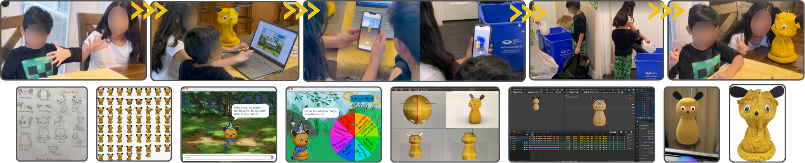
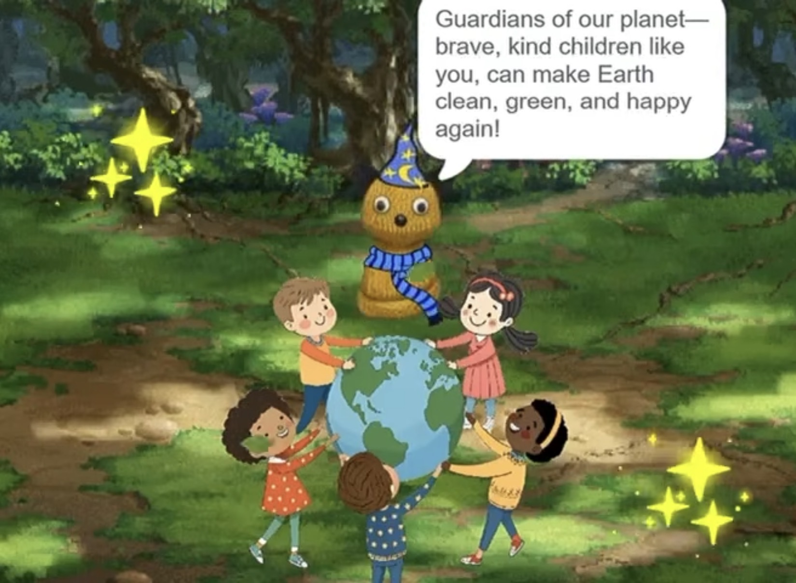
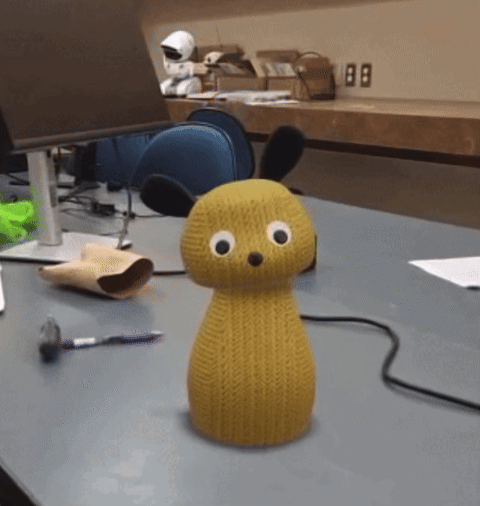
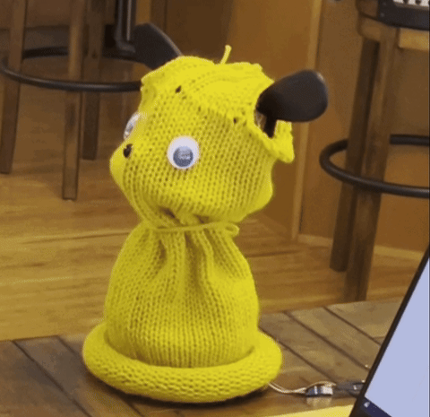

# “Guardians of the Planet”: A Multi-Realm Robot Bridging Learning and Real-World Sustainability for Children

**ACM Interaction Design and Children (IDC 2026)** · **Research and Design Challenge — Second Place (team)**

**Publication:** [Read the conference paper](https://doi.org/10.1145/3773077.3815130)  
**Authors:** Adesoye Oluwakorede Oyeyiola, **Harsh Dadhwal**, Devasena Pasupuleti, Gerardo Chavez Castaneda, Ben Knutson, and Shruti Chandra  
**Venue:** *Proceedings of the 25th Annual ACM Interaction Design and Children Conference*, 2026, pp. 1367–1370.

## Overview

How might a social robot connect digital learning with real-world sustainability activities for children?

*Guardians of the Planet* explores this question through a shared character—**Blossom**—across three connected experiences: a 2D educational game, an augmented-reality (AR) activity, and an interaction with a physical social robot. The prototype uses a common narrative and character identity to carry a sustainability-themed learning experience between digital and physical settings.

The project was developed collaboratively for the IDC 2026 Research and Design Challenge and received **second place**. For research context and the original claims, see the [published paper](https://doi.org/10.1145/3773077.3815130).



*Project overview. Reproduced from [the paper](https://doi.org/10.1145/3773077.3815130), licensed under [CC BY 4.0](https://creativecommons.org/licenses/by/4.0/). Participant faces are blurred as in the published paper.*


## The Three Realms

| Realm | Experience | Purpose |
| --- | --- | --- |
| **2D game** | Children engage with an educational game featuring Blossom. | Introduce and reinforce sustainability concepts through play. |
| **Augmented reality** | Blossom accompanies a sustainability-oriented activity in AR. | Bridge screen-based guidance with observation or action in the environment. |
| **Physical robot** | A tangible Blossom robot performs expressive behaviors. | Bring the character into the real world and conclude the experience with social interaction. |

The published prototype's realms were **independently functional**. The transition to the physical robot used a **Wizard-of-Oz operator** to time robot gestures with the AR sequence.

## System Design

The design emphasizes continuity of Blossom's identity across all three representations. A shared childlike text-to-speech voice supports that continuity. In the physical realm, the soft Blossom robot expresses social gestures through its motor-driven body.

<h2>Multi-Realm Experience</h2>

<table>
  <tr>
    <th>Digital</th>
    <th>Augmented Reality</th>
    <th>Physical</th>
  </tr>
  <tr>
    <td width="33%">
      
    </td>
    <td width="33%">
      
    </td>
    <td width="33%">
      
    </td>
  </tr>
</table>


## Research Contribution

This work brings together child-centered design, game-based learning, augmented reality, and social robotics in a single sustainability-learning narrative. It demonstrates a working multi-realm prototype and discusses the opportunities and constraints of carrying a robot's character and interaction across media.

The project was a **team effort**.

## Recognition

**Second Place — IDC 2026 Research and Design Challenge (Adult Track) (team award).**

[Conference publication](https://doi.org/10.1145/3773077.3815130)


[Certificate of recognition](assets/idc26-rdc-2nd-place-certificate.pdf)


## Research Materials and Availability

This repository is a research companion to the published paper. It includes selected project images and demonstrations of the three realms. Source code is not distributed here.

## Limitations and Future Work

The conference paper describes a functional prototype rather than a fully autonomous, continuously connected system. The physical robot was operated using Wizard-of-Oz timing, and real-time interconnection and independent robot perception were identified as future directions.

## Citation

Please cite the published conference paper rather than this repository:

```bibtex
@inproceedings{oyeyiola2026guardians,
  title={``Guardians of the Planet'': A Multi-Realm Robot Bridging Learning and Real-World Sustainability for Children},
  author={Oyeyiola, Adesoye Oluwakorede and Dadhwal, Harsh and Pasupuleti, Devasena and Castaneda, Gerardo Chavez and Knutson, Ben and Chandra, Shruti},
  booktitle={Proceedings of the 25th Annual ACM Interaction Design and Children Conference},
  pages={1367--1370},
  year={2026},
  publisher={ACM},
  doi={10.1145/3773077.3815130}
}
```

## Acknowledgments

We acknowledge the contributions of all project collaborators, the guidance of Dr. Shruti Chandra, and the children whose ideas informed the challenge design. Details of participant involvement are described in the published paper.

The physical robot is built on [Blossom](https://github.com/hrc2/blossom-public), an open-source handcrafted social robot platform developed by Michael Suguitan and Guy Hoffman at Cornell University ([Suguitan & Hoffman, 2019](https://doi.org/10.1145/3310356)).


## My Contribution

I built and programmed the physical Blossom robot and ran workshops with children to gather their feedback on the design. I also contributed to the AR experience and the paper.

---

**Design and scientific reference:** [Oyeyiola et al., IDC 2026](https://doi.org/10.1145/3773077.3815130). The conference paper is published under [CC BY 4.0](https://creativecommons.org/licenses/by/4.0/). Other project media in this repository are shared by the authors for illustration and are not covered by that license.
